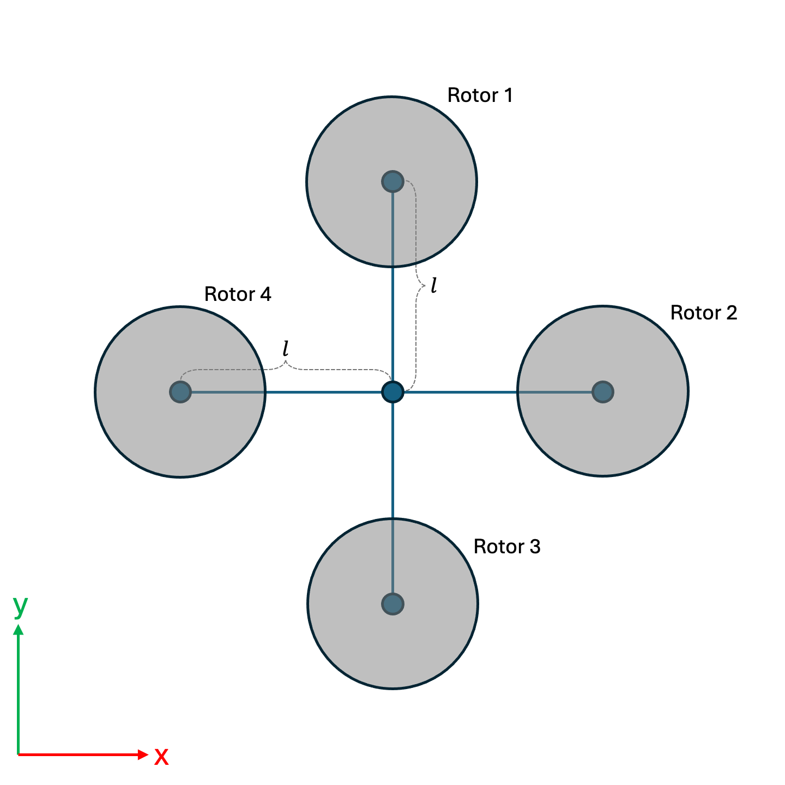

# Lab 3 - Drone Stabilization with LQR

In this lab, you will model a quadrotor using a linearized state-space model and will apply LQR to stabilize the quadrotor's hover.

## LQR Quadrotor Control
In this lab, you will implement ideas discussed in class regarding optimal control and the LQR problem.
Specifically, you will use LQR in order to stabilize the hover of a quadrotor.

The quadrotor is controlled by applying forces to each of its rotors. You can control each of the four rotors.
You will derive a linearized dynamics of a quadrotor, and you will then apply LQR to get the quadcopter to achieve a stable hover at $(0,0,1)$ (i.e., height of 1 above the origin).

You will first implement open-loop controls that stabilize the quadcopter if it already starts in stationary, level flight. These controls correspond to the forces applied by the rotors that are needed to maintain the stationary, level hover.

Then, you will run those open-loop controls if the robot starts perturbed from a level, stationary hover, and you will see whether open-loop control can cope with imperfections and disturbances.

To perform better when faced with disturbances, we can use closed-loop (feedback) control. One way of doing this is using LQR, as described in lecture. By using LQR, the quadrotor should be able to achieve the desired state, even if when starting in non-level flight or when faced with disturbances.

You should model the quadrotor as having 4 rotors where we can control the robot by applying forces at each rotor. The image below shows the rotor configuration of the quadrotor in this assignment:



You should use a state of the form:
$$\mathbf{x}=\begin{bmatrix} p_x & p_y & p_z & \theta_x & \theta_y & \theta_z & v_x & v_y & v_z & \omega_x & \omega_y & \omega_z \end{bmatrix}^T$$
where $p_x$, $p_y$, and $p_z$ represent the position of the robot in the *world* frame; $\theta_x$, $\theta_y$, and $\theta_z$ are the $x$, $y$, and $z$ Euler angles of the robot in *world* frame; $v_x$, $v_y$, and $v_z$ represents the linear velocity of the robot in *body* frame; and $\omega_x$, $\omega_y$, and $\omega_z$ represent the angular velocity of the robot in *body* frame.

## Quadrotor Dynamics
The quadrotor has forces applied to each rotor in *body* frame; call the force from each rotor $i \in \{1,2,3,4\}$ as $f_i$. Note that the rotor force $f_i$ acts at the rotor, not the center of mass of the robot, so it can produce a torque.

We can write $f_i=f_{ol}+\delta f_i$, where $f_{ol}$ is the open-loop force that would be needed to maintain equilibrium (if you start at equilibrium). Aside from the force from each of the four rotors, gravity also acts on the robot, applying a force $$\begin{bmatrix}0 & 0 & -mg\end{bmatrix}^T$$ in *world* frame (where $m$ is mass and $g=9.8 \frac{m}{s^2}$ is the gravitational constant).

In addition, since the force on each rotor acts at the point of the rotor, the robot can experience a torque from each rotor. Similarly, the first and third rotors spin in an opposite direction from the second and fourth rotors (to prevent the robot from yawing out of control). This leads to a drag torque. Specifically, the total torque on the robot from the rotors can be described (in *body* frame) as:

$$
\begin{bmatrix}\mathbf{\tau}_{x} \\ \mathbf{\tau}_{y} \\ \mathbf{\tau}_{z}\end{bmatrix} = \begin{bmatrix} l (f_1 - f_3)\\ l (f_4 - f_2) \\ k_d (f_1 - f_2 + f_3 - f_4)\end{bmatrix}
$$

where $l$ is the length of the rotor arms (as pictured in the image above) and $k_d$ is a drag constant. We assume the robot has a diagonal inertia matrix $\mathbf{I}=\begin{bmatrix} \mathbf{I}_x & 0 & 0 \\ 0 & \mathbf{I}_y & 0 \\ 0 & 0 & \mathbf{I}_z \\\end{bmatrix}$ that we can use for calcualting how the torque affects the angular acceleration of the quadrotor.

From the above, you can derive the linearized dynamics (see the later section for hints to help with the linearized equation derivations). The following (linearized) dynamics govern the quadrotor near an equilibrium point $\mathbf{x}_{equil} \approx \mathbf{0}$:

$$
\dot{\mathbf{p}}=\begin{bmatrix} \dot{p}_x \\ \dot{p}_y \\ \dot{p}_z\end{bmatrix}=\begin{bmatrix}v_x \\ v_y \\ v_z\end{bmatrix}
$$

$$
\dot{\mathbf{\theta}}=\begin{bmatrix} \dot{\theta}_x \\ \dot{\theta}_y \\ \dot{\theta}_z\end{bmatrix}=\begin{bmatrix}\omega_x \\ \omega_y \\\omega_z\end{bmatrix}
$$

$$
\dot{\mathbf{v}}=\begin{bmatrix}\theta_y \, g\\ -\theta_x \, g \\ \sum_{i=1}^4{\frac{\delta f_i}{m}} \end{bmatrix}
$$

$$
\dot{\mathbf{\omega}}=\begin{bmatrix}\frac{l}{\mathbf{I}_x}(\delta f_1 - \delta f_3) \\ \frac{l}{\mathbf{I}_y}(\delta f_4 - \delta f_2) \\ \frac{k_d}{\mathbf{I}_z}(\delta f_1 - \delta f_2 + \delta f_3 - \delta f_4) \end{bmatrix}
$$

## Hints for Deriving the Linearized Dynamics Equations

For deriving the linearized system $\dot{\mathbf{x}} = A\mathbf{x} + B\mathbf{u}$ from scratch, the following are useful:
- For a small rotation $\theta$ about axis $\mathbf{d}$, we have $R=Rot(\mathbf{d},\theta)=e^{[\mathbf{d}]\theta} \approx I +[\mathbf{d}]\theta$.
- The Euler's rotation equations state $\mathbf{I}\dot{\omega}+\omega \times (\mathbf{I} \omega) = \mathbf{\tau}_{net}$. Note that in Euler's rotation equations: $\mathbf{\tau}_{net}$ is the net torque, $\omega$ is the angular velocity (in body frame), and $\mathbf{I}$ here is the *inertia* matrix (not to be confused with $I$ which is the identity matrix).


## What you need to do

### Part 1 - Open-Loop Control
First, you will implement the open-loop controls that are needed to allow the quadrotor to continue hover in place if it starts in a stationary hover.

Before you start your implementation, run:
```
python3 assignments/drone_lqr/main.py --controlMethod openloop
```

As expected, if we don't have the rotors spin to apply a force to prevent the quadrotor from falling, the robot just falls down.

Now, calculate the force on each rotor that is needed to have the robot hover in place, assuming it starts from a stationary and level hover, and implement the following in `implementation.py`:
- `computeControlOpenLoop` - this function should return the $f_1$, $f_2$, $f_3$, and $f_4$ that are needed to have the robot maintain hover if it starts in a level, stationary hover. Hint: the force $f_{ol}$ exerted by each rotor should be the same for all rotors.

After you implemented the open-loop controls, run:
```
python3 assignments/drone_lqr/main.py --controlMethod openloop
```
If you implemented the controls correctly, the robot should maintain its hover.

Now, let's see what happens if the robot doesn't start in level flight. Run:
```
python3 assignments/drone_lqr/main.py --controlMethod openloop --startRandom
```

As you can see, the open-loop controls are not sufficient for maintaining a hover if the robot does not start out level and in a stationary hover. This is due to the inability of open-loop control to use feedback about the system to correct itself to achieve desired behavior.

### Part 2 - Feedback Control with LQR
To address the issue of open-loop controls failing unless the robot starts in a level, stationary hover, we can use feedback control. As discussed in lecture, one common method of feedback control is LQR.

For this scenario, we will assume an infinite-time, continuous LQR problem. While technically our system is neither infinite time nor continuous, our timescale is large and timesteps are small so this approximation can still give quite good results. We want to use LQR to achieve a state $$\mathbf{x}_{desired}=\begin{bmatrix}0 & 0 & 1 & 0 & 0 & 0 & 0 & 0 & 0 & 0 & 0 & 0\end{bmatrix}^T$$ (i.e., position $p_x=0,p_y=0,p_z=1$ with zero rotation, zero velocity, and zero angular velocity).

Recall that for infinite-horizon, continous-time LQR, we have a linear system:

$$\dot{\mathbf{x}} = A\mathbf{x} + B\mathbf{u}$$ (more details on this system are given in the "Quadrotor Dynamics" section above)

and a cost function:

$$J=\int_{0}^{\infty} {\mathbf{x}^T Q \mathbf{x} +\mathbf{u}^TR\mathbf{u}} \, dt$$

where $Q$ and $R$ are cost matrices.

LQR can be used to find the feedback controls $\mathbf{u}=f(\mathbf{x})$ that optimize the cost function.

You should create a feedback controller based on LQR by implementing the following functions in `implementation.py`:
- `getRobotState` - should return the 12-dimensional vector that represents the robot's state.
- `getSystemMatrix` - should return the 12-by-12 matrix that corresponds to the $A$ matrix for our linearized system $\dot{\mathbf{x}} = A\mathbf{x} + B\mathbf{u}$.
- `getInputMatrix` - should return the 12-by-4 matrix that corresponds to the $B$ matrix for our linearized system $\dot{\mathbf{x}} = A\mathbf{x} + B\mathbf{u}$.
- `getLQRCostMatrices` - should return the cost matrices `Q` and `R` that define our cost function. You should pick these matrices so that they are positive-definite and stabilize the quadrotor to a hover. Hint: even simple diagonal matrices will work.
- `computeControlLQR` - should compute the controls $f_1$, $f_2$, $f_3$, and $f_4$ that achieves the desired behavior of reaching $\mathbf{x}_{desired}$ using LQR.
    - Hint #1: you should "shift" your equilibrium to the desired state.
    - Hint #2: the resulting control should be $f_i=f_{ol}+\delta f_i$ for $i \in \{1,2,3,4\}$, where $\delta f_i$ is found via LQR.
    - Hint #3: use the function `self.solveContinuousARE(A,B,Q,R)` to solve the Riccati equation.

Once you've completed your implementation, run:
```
python3 assignments/drone_lqr/main.py --controlMethod lqr --startRandom
```
If your implementation is correct, the quadrotor should gracefully be controlled to equilibrium state $\mathbf{x}_{desired}$.

In addition, you can add additional perturbations to see how your LQR controller can deal with stabilizing perturbations that mimic external forces like wind gusts using:
```
python3 assignments/drone_lqr/main.py --controlMethod lqr --startRandom --applyPerturbations
```